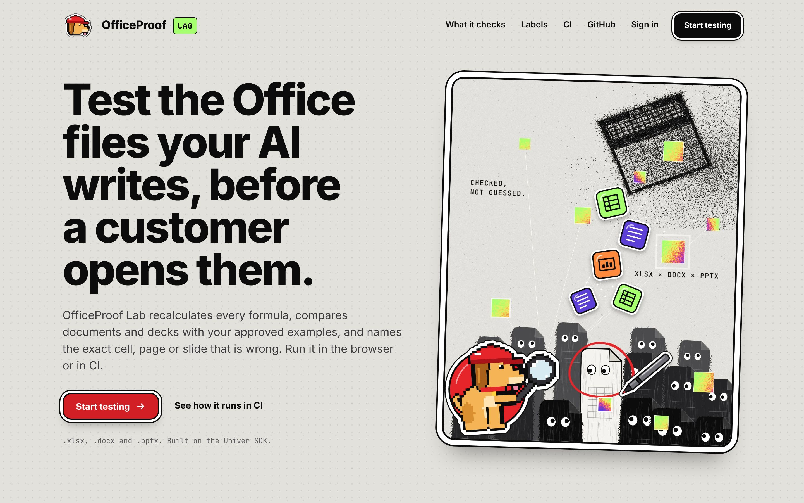
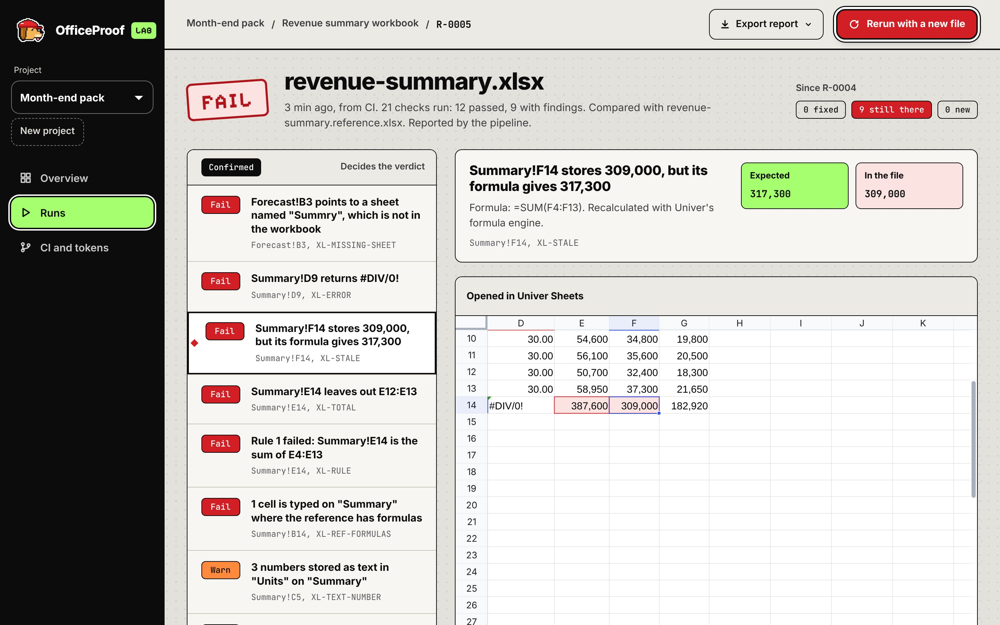
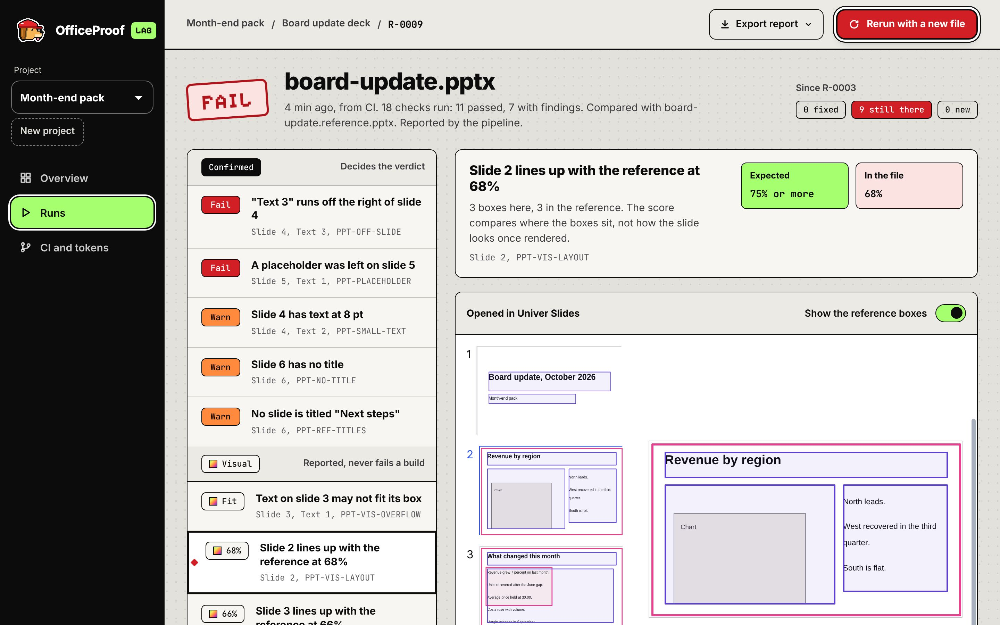
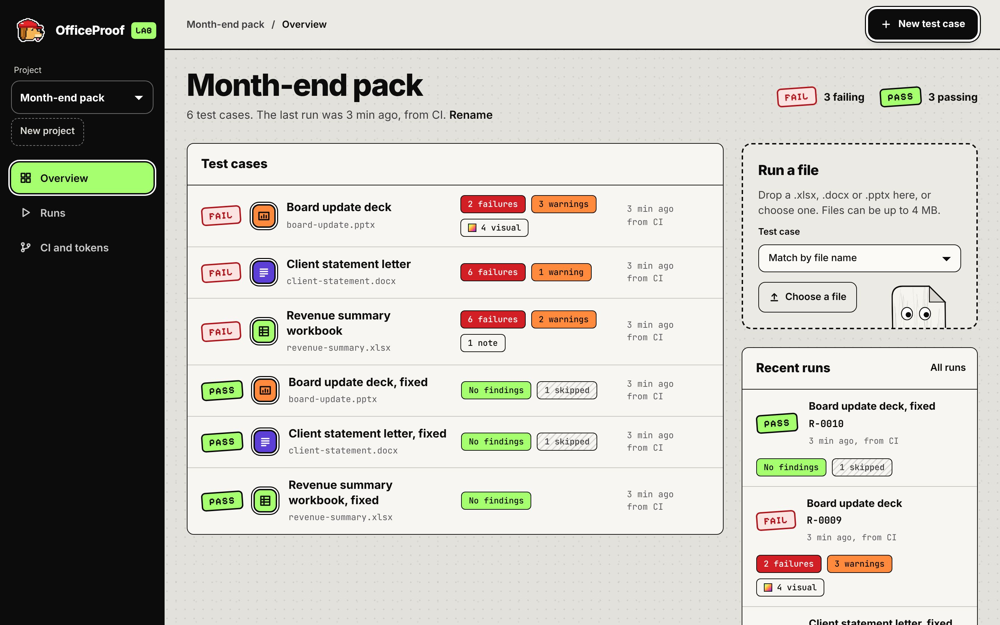

# OfficeProof Lab

Tests the Office files your AI writes, before a customer opens them.

OfficeProof Lab recalculates every spreadsheet formula with the [Univer](https://univer.ai) formula engine, compares documents and decks with your approved examples, and names the exact cell, paragraph or slide that is wrong. It runs in the browser and in CI, on `.xlsx`, `.docx` and `.pptx`.



## What a run looks like

A failing workbook, opened in Univer Sheets with the flagged cell selected:



A deck compared with its approved reference, opened in Univer Slides:



A project, with test cases that arrived from the browser and from a pipeline:



## Three labels, never mixed

| Label | What it is | Effect |
| --- | --- | --- |
| **Confirmed** | Deterministic test results. The same file, reference and rules always give the same findings | Decides the verdict and the CI exit code |
| **Visual** | Layout compared by where boxes sit, and an estimate of whether text fits. Not a rendering | Reported; never fails a run |
| **AI-assisted** | Optional notes from Ling 3.2 Flash, each tied to a quote found in the file | Reported; never fails a run |

A check that could not run is shown as skipped, and a formula that could not be calculated is shown as not verified. Neither counts as a pass.

## What it checks

- **Spreadsheets:** formulas that return errors or point to a missing sheet, stored results that differ from what the formula gives, circular references, totals that do not match their rows, formulas that break the pattern of their neighbours, numbers stored as text, blanks inside tables, and your own rules (expected values, sums, headers).
- **Documents:** leftover placeholders and assistant text, unconverted Markdown, empty sections, table totals that do not add up, missing images, tracked changes left in, and headings, tables, page setup and fonts compared with a reference.
- **Slides:** content outside the slide, placeholders, empty slides, missing titles, text too small to read, overlapping boxes, and slide count, size, titles, fonts and layout compared with a reference.

`node dist/officeproof.cjs checks` lists all 56 with their ids.

## Try it

Needs Node 22 or later for the app (Node 20 is enough for the command-line tool).

```bash
npm install
npm run dev                # the app, at http://127.0.0.1:3000
npm run check:samples      # the command-line tool on the sample files
```

On your own machine the app keeps its data in a private SQLite file, so there is nothing else to set up. Create an account, drop in a file from `samples/generated/`, then drop in the matching file from `samples/fixed/` to see what was fixed.

`samples/` holds three synthetic files with seeded defects, their fixed versions and their approved references. `npm run samples` generates them again.

## In CI

```yaml
- uses: 0xNexuz/officeprooflab@main
  with:
    config: officeproof.json
```

The step fails the job on a confirmed failure and writes JSON, Markdown, JUnit and HTML reports. With a project token it also sends each run to the dashboard. The [integration guide](docs/INTEGRATION.md) covers the config file, rules, other pipelines and the upload endpoint.

## Hosting

The app is a Next.js project. When hosted it needs a Postgres database:

| Variable | Needed | Meaning |
| --- | --- | --- |
| `DATABASE_URL` | Yes, when hosted | Postgres connection string. Tables are created on first use |
| `ANT_LING_API_KEY` | No | Turns on AI-assisted observations. Without it everything else works |

See [`.env.example`](.env.example). Secrets stay on the server; pipeline tokens are stored hashed.

## How it is built

| Part | Where |
| --- | --- |
| Check engine: reads the Office files, recalculates with Univer headless, runs the checks. No app code | `lib/engine` |
| Command-line tool and GitHub Action | `cli/`, `dist/officeproof.cjs`, `action.yml` |
| App: accounts, projects, test cases, runs, tokens | `app/`, `lib/server` |
| Inspection in Univer Sheets, Docs and Slides | `lib/univer-*.ts`, `components/Inspectors.tsx` |

Univer 1.3.1, open-source packages only. Univer has no open-source Office import, so OfficeProof Lab reads `.xlsx`, `.docx` and `.pptx` itself and builds Univer data from them. The slide and document views are rebuilt from each file's structure for inspection; they are not a rendering of the original design.

## Development

```bash
npm test                 # engine and store tests
npm run typecheck
npm run build
npm run build:cli && npm run check:samples
npm run test:postgres    # needs OFFICEPROOF_TEST_DATABASE_URL
```

`docs/PROPOSAL.md` is the proposal this project implements, `docs/CLIENT_SCOPE.md` maps each promise to a feature, and `docs/BUILD_LEDGER.md` records what was built and verified.

## Limits

Files up to 4 MB. No legacy formats (`.xls`, `.doc`, `.ppt`), charts or pivot tables. Macros are never run. Visual findings compare geometry, not pixels. More in the [integration guide](docs/INTEGRATION.md#7-limits).

## Licence

Not yet chosen. Until the owner adds a licence file, all rights are reserved.
