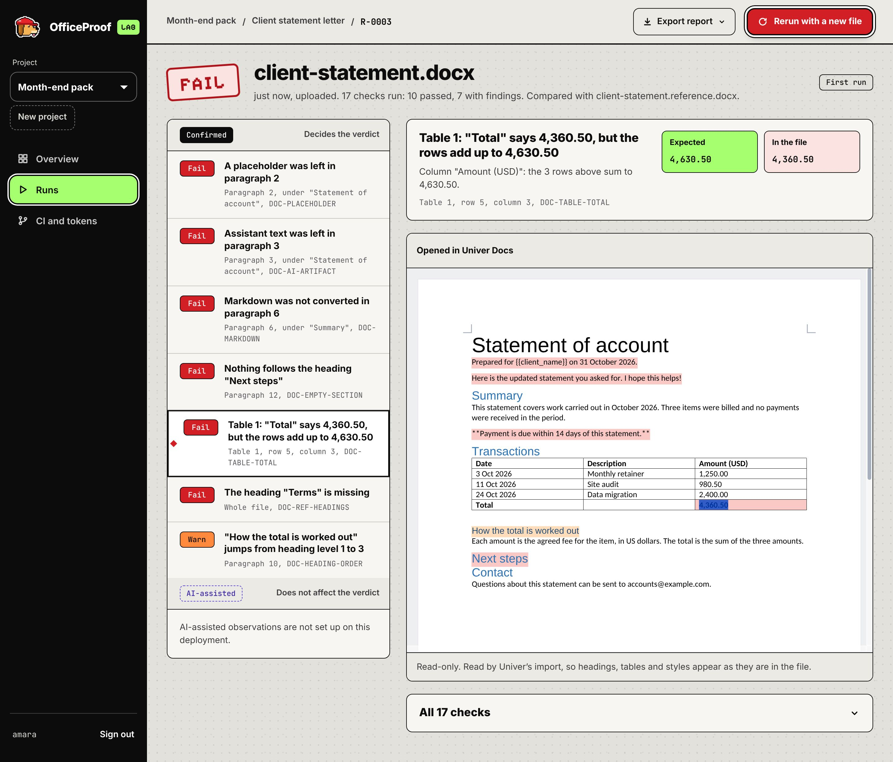
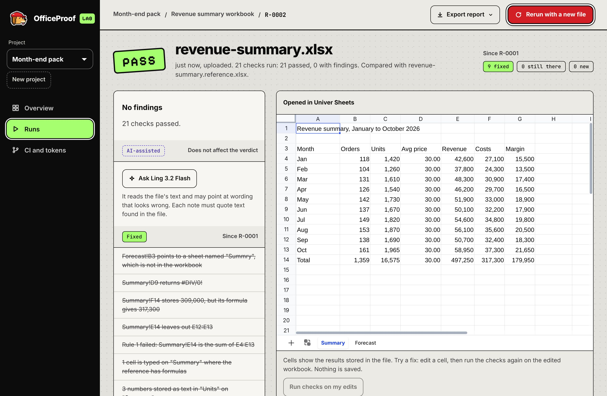
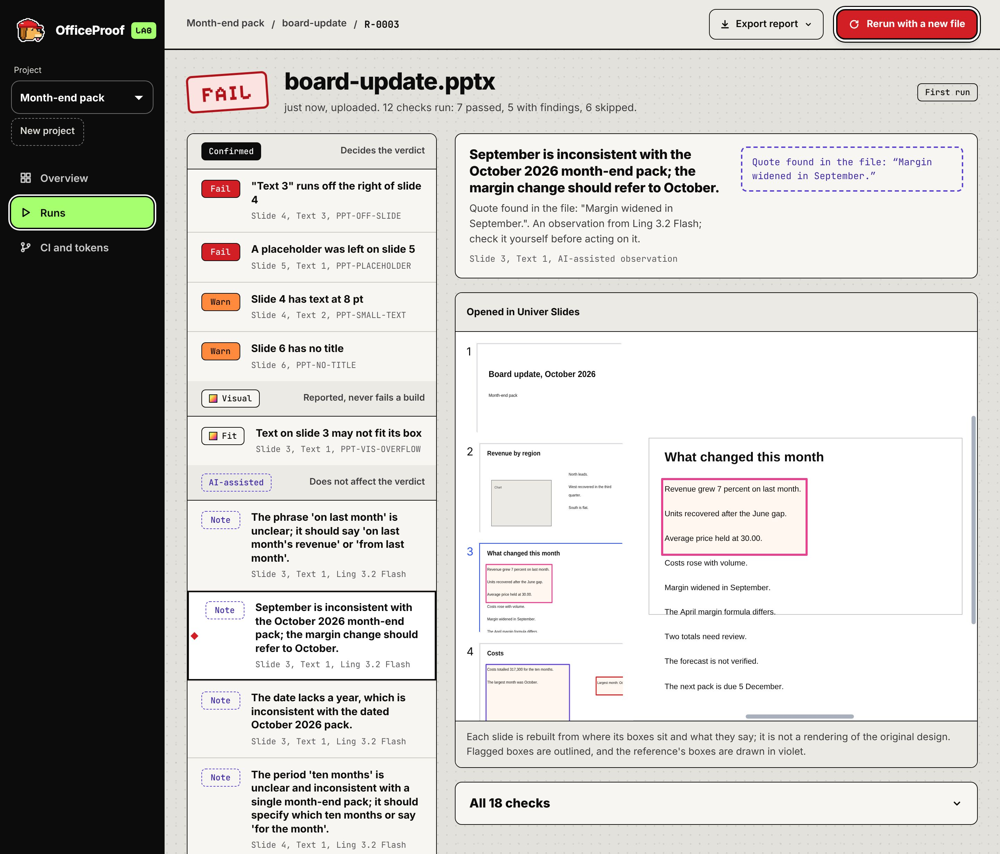

# OfficeProof Lab

**Test the Office files your AI writes, before a customer opens them.**

AI agents now generate spreadsheets, documents and slide decks that go straight to customers. OfficeProof Lab checks those files first. It recalculates every formula, compares documents and decks with your approved examples, and names the exact cell, paragraph or slide that is wrong.

It works on `.xlsx`, `.docx` and `.pptx`, in the browser and in CI. Built with the [Univer](https://univer.ai) SDK and [Ant Ling](https://ant-ling.com)'s Ling 3.2 Flash.

**Live:** https://officeprooflab.vercel.app


## What it does

- **Checks the file itself.** Upload a generated file, or let your pipeline send it. Every formula is recalculated and compared with the value stored in the file.
- **Points at the problem.** Each finding names one cell, paragraph or slide, and the file opens there in Univer Sheets, Docs or Slides.
- **Compares with an approved example.** Give a test case a reference file, and each run is checked against its sheets, headings, tables, slide count and layout.
- **Follows your own rules.** For example: this cell is the sum of that range, this heading must exist, the deck has six slides.
- **Shows what a fix changed.** Rerun a test case and see what is fixed, what is still there and what is new.
- **Reports and CI.** Export a report as HTML, Markdown, JSON or JUnit XML, and run the same checks on every pull request.

## See it

**A generated workbook fails.** The stored total is 309,000, but the formula gives 317,300. The flagged cell is selected in Univer Sheets.


**A generated letter fails.** The table's total says 4,360.50, but its rows add up to 4,630.50. The document is read by Univer's import, so it opens in Univer Docs with its own headings and table.



**A deck compared with its approved reference.** A text box runs off slide 4, and slide 2 lines up with the reference at 68%.


**The regenerated file passes.** The run shows what changed since the last one: 9 fixed, 0 still there, 0 new.



**Notes from Ling 3.2 Flash.** Each note quotes a line from the file, and none of them affects the verdict.



<sub>The notes are the ones Ling 3.2 Flash gave on the live site for the sample deck on 10 November 2026. The screenshot is from a local copy with those notes loaded unchanged. All sample files are synthetic.</sub>

## Three labels, never mixed

Every finding says how sure it is.

| Label | What it is | Effect |
| --- | --- | --- |
| **Confirmed** | A test result. The same file, reference and rules always give the same findings | Decides the verdict and the CI exit code |
| **Visual** | Layout compared with the reference by where boxes sit, and an estimate of whether text fits | Reported. Never fails a run |
| **AI-assisted** | Optional notes from Ling 3.2 Flash, each tied to a quote found in the file | Reported. Never fails a run |

Anything that could not be checked is shown as skipped or not verified. It is never counted as a pass.

## What it checks

| File | Examples |
| --- | --- |
| **Spreadsheets** | Stored results that differ from the formula, formulas that return an error or point to a missing sheet, totals that do not match their rows, formulas that break the pattern of their neighbours, numbers stored as text |
| **Documents** | Leftover placeholders, assistant text left in, Markdown that was not converted, table totals that do not add up, empty sections, headings and tables compared with the reference |
| **Slides** | Content outside the slide, placeholders, empty slides, missing titles, text too small to read, slide count, titles and layout compared with the reference |

There are 56 checks in all. `node dist/officeproof.cjs checks` lists them.

## Try it

1. Open https://officeprooflab.vercel.app and create an account.
2. Drop in a file from [`samples/generated`](samples/generated). Each one has seeded defects, so the run fails and shows you where.
3. Drop in the matching file from [`samples/fixed`](samples/fixed) to see what was fixed.

To compare with an approved example, create a test case and add the matching file from [`samples/reference`](samples/reference).

## Use it in CI

Add one step after the step that generates your files:

```yaml
- uses: 0xNexuz/officeprooflab@main
  with:
    config: officeproof.json
```

The build fails only on a confirmed failure. With a project token, each run is also sent to your dashboard, next to the runs from the browser.


The [integration guide](docs/INTEGRATION.md) covers the config file, rules, other pipelines and the command-line tool.

## How Univer is used

| Univer | In OfficeProof Lab |
| --- | --- |
| Formula engine | Recalculates each workbook with no editor open, on the server, on the command line and in CI |
| Office import (Univer Pro) | Reads each file into Univer's own format on the server, so the viewer shows the file with its own formatting |
| Univer Sheets | Opens the workbook with flagged cells marked. You can edit a cell and rerun the checks on the edited copy |
| Univer Docs | Opens the document with flagged paragraphs and table cells marked |
| Univer Slides | Opens the deck with flagged boxes outlined and the reference's boxes drawn over it |

All packages are version 1.3.1.

**The checks need no licence.** They use open-source Univer packages and OfficeProof Lab's own reading of each file, so a verdict is the same in the browser, on the command line and in CI.

**The viewer uses Univer's Office import** (`@univerjs-pro/exchange-node`, part of Univer Pro). It runs inside the server and no file leaves it.

- Workbooks and documents open with the fonts, fills, column widths, headings and tables they have in the file.
- Decks open with their own design when a Univer browser licence is set. Without one, each slide is drawn from where its boxes sit.
- If the import is not available, or a finding cannot be placed on the imported file, the view is built from OfficeProof Lab's own reading instead. No finding is ever hidden.

## How Ling 3.2 Flash is used

- It has one job: read a file's text and point at wording that looks wrong.
- A note is kept only if its quote is found in the file.
- Its notes carry the AI-assisted label. They never change a verdict or fail a build.

The feature is optional. Every check and report works without it.

## Run it yourself

Needs Node.js 22.6 or later.

```bash
npm install
npm run dev            # http://127.0.0.1:3000
```

On your own machine nothing else is needed: data is kept in a private local file.

To host it (for example on Vercel), set two server-side variables:

| Variable | Needed | What it is |
| --- | --- | --- |
| `DATABASE_URL` | Yes | A Postgres connection string. Tables are created on first use |
| `ANT_LING_API_KEY` | No | Turns on the notes from Ling 3.2 Flash |
| `NEXT_PUBLIC_UNIVER_LICENSE` | No | Univer's browser licence (the contents of `license.txt`). Shows decks with their own design. Set it before the build |
| `OFFICEPROOF_UNIVER_IMPORT` | No | Set to `off` to turn Univer's Office import off. The viewer then uses OfficeProof Lab's own reading |

Univer's server licence key (`licenseKey.txt`) is not used and must never be put in a `NEXT_PUBLIC_` variable.

`GET /api/import/status` reports whether Univer's Office import works on the server.

## Limits

- Files up to 4 MB.
- `.xlsx`, `.docx` and `.pptx` only. Older formats (`.xls`, `.doc`, `.ppt`) are not read.
- Charts and pivot tables are not checked. Macros are never run.
- Visual findings compare where boxes sit. They are not a pixel comparison.
- Univer's Office import needs a server on Linux (glibc), macOS or Windows. Elsewhere the viewer works without it.

## Licence

[MIT](LICENSE). Univer and the other libraries OfficeProof Lab uses keep their own licences. The `@univerjs-pro` packages are part of Univer Pro and come under Univer's own terms.
